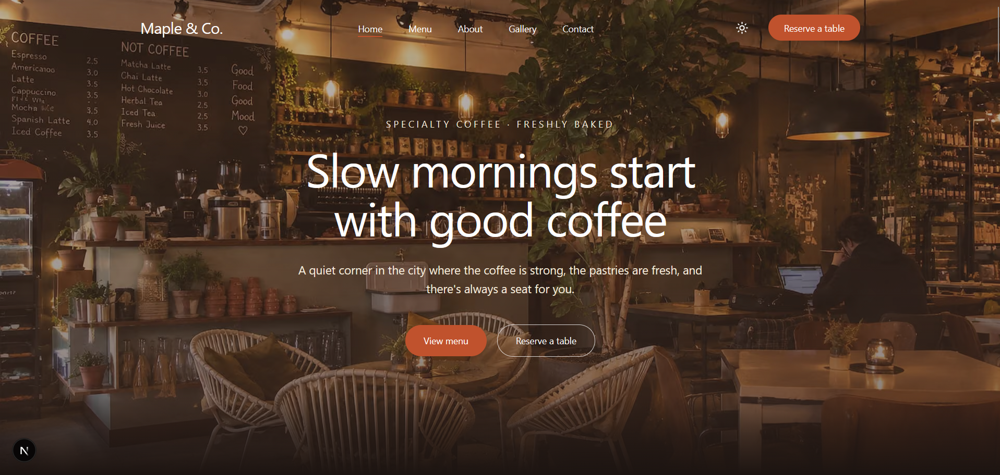
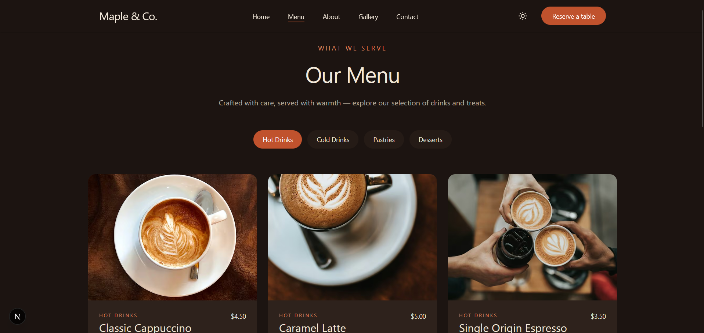
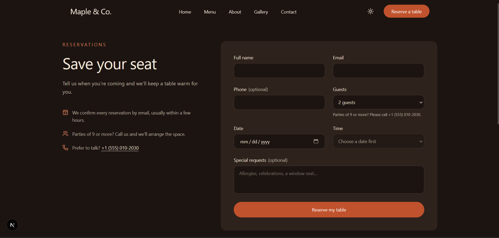

Cafe Website Template ☕

A modern, responsive cafe website built with Next.js, React, TypeScript, and Tailwind CSS. The project focuses on creating an elegant user experience with polished layouts, interactive components, and performance-conscious design.

✨ Features

- Responsive Design — Layouts designed for desktop, tablet, and mobile screens.
- Multiple Pages — Home, About, Menu, Gallery, Contact, and Reservation pages.
- Dark Mode — Theme toggle for a more comfortable browsing experience.
- Interactive Gallery — Image gallery with a lightbox experience.
- Menu Showcase — Organized menu sections featuring cafe drinks and desserts.
- Reservation Interface — A reservation form with input validation.
- Reusable Components — Shared UI components for a consistent design.
- SEO Improvements — Metadata, sitemap, robots configuration, and structured data.
- Subtle Animations — Motion effects that enhance the browsing experience.
- Accessibility and Performance — Attention to usability and efficient page rendering.

🛠️ Built With

- Next.js
- React
- TypeScript
- Tailwind CSS
- Motion
- Lucide React

🚀 Getting Started

Prerequisites

Make sure you have Node.js and npm installed.

Installation

1. Clone the repository:
   
   git clone https://github.com/amneh07/cafe-website-template.git

2. Navigate to the project directory:
   
   cd cafe-website-template

3. Install dependencies:
   
   npm install

4. Start the development server:
   
   npm run dev

5. Open "http://localhost:3000" (http://localhost:3000) in your browser.

📁 Project Structure

src/
├── app/          # Application pages and global styles
├── components/   # Reusable UI and page components
├── data/         # Menu, gallery, navigation, and site data
└── lib/           # Validation and utility functions
public/
└── images/       # Website images and visual assets

📌 Project Status

This project focuses on the frontend experience. The reservation interface is currently a frontend feature and is not presented as a connected booking backend.

👩‍💻 Author

Amneh

- GitHub: "@amneh07" (https://github.com/amneh07)

## 📸 Screenshots

### Homepage

### Menu

### Gallery
